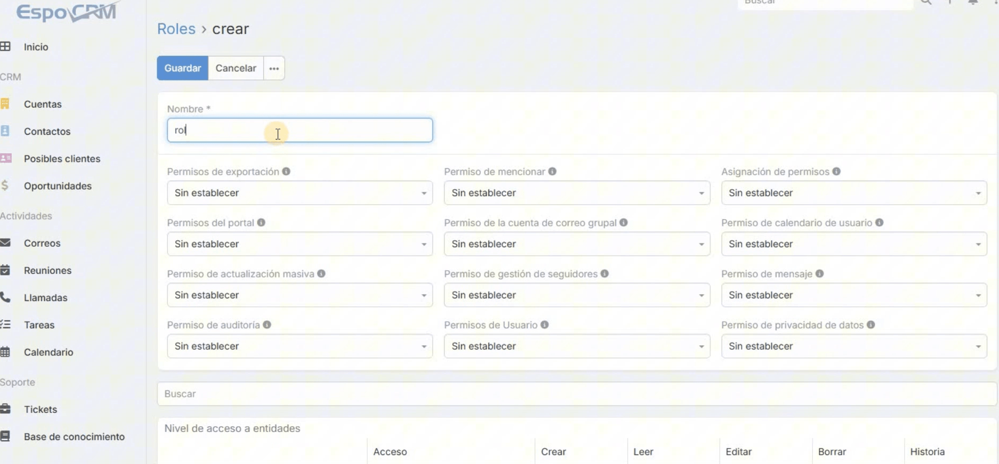

Un usuario en EspoCRM puede tener acceso por dos vías al mismo tiempo: un Rol asignado directamente y uno o varios Roles heredados por pertenecer a un Equipo. Cuando ambas vías definen niveles distintos para la misma acción, EspoCRM aplica el nivel más alto o más permisivo de los dos. No hay prioridad entre "rol directo" y "rol heredado": gana el que da más acceso.

Esta regla es la que hay que tener presente al diseñar permisos, porque el resultado final para un usuario no depende solo de su Rol individual, sino de la suma de todos los Equipos a los que pertenece.

Para dimensionar la regla: en sistemas como AWS IAM o Kubernetes RBAC, una denegación explícita suele tener prioridad sobre un permiso explícito cuando hay conflicto. En EspoCRM el criterio es distinto: siempre gana el nivel más permisivo. Tenerlo claro ayuda a anticipar cómo se comporta el sistema cuando un usuario acumula varios Equipos con el tiempo, que es lo habitual en cualquier organización.

## Los 5 niveles de acceso

Cada acción se configura con uno de estos niveles:

- **No**: sin acceso
- **Propio**: solo registros propios
- **Equipo**: registros de su(s) Equipo(s)
- **Todos**: todos los registros de la organización

Forman una escala ordinal. Cuando revisas el Rol de un usuario y ves `Equipo` en una acción, ese no es necesariamente el límite real: si pertenece a otro Equipo cuyo Rol da `Todos` en la misma acción, el acceso efectivo es `Todos`. Por eso revisar el Rol individual no es suficiente — hace falta revisar también la lista completa de Equipos del usuario.

## Acciones controladas por Rol

Cada entidad (Cuenta, Oportunidad, Contacto, entidad custom, etc.) tiene su propia matriz de acceso sobre estas acciones:

- **Crear** — crear registros de este tipo
- **Leer** — ver registros
- **Editar** — modificarlos
- **Borrar** — eliminarlos
- **Historia** — ver y participar en el feed de actividad del registro (comentarios, seguimiento)

Cada acción se configura por separado, y todas siguen la misma regla de resolución al cruzar Equipos.

## Permisos especiales

Fuera de la matriz por entidad, hay permisos globales que no se rigen por Propio/Equipo/Todos porque no definen "qué registros" sino "qué operación":

- **Exportación de datos** — habilita sacar información del sistema a CSV/Excel. Vale la pena revisarlo con cuidado: un usuario puede tener `Propio` en Contactos dentro de la matriz normal, pero si tiene permiso de exportación por un Rol heredado y además `Todos` en algún otro cruce, puede exportar el dataset completo.

- **Privacidad de datos** — controla acciones como anonimizar o borrar datos personales, relevante si la implementación maneja información bajo normativas de protección de datos.

## Seguridad a Nivel de Campo

Esta capa opera de forma independiente al acceso al registro. Un usuario puede tener `Editar: Todos` sobre Oportunidades y aun así no poder modificar un campo específico, como `Monto`, si el Rol lo restringe a solo lectura o lo oculta.

Se usa para casos donde alguien necesita ver o editar un registro completo, pero no todos sus campos: por ejemplo, un vendedor con `Todos` en Oportunidades para ver el pipeline del equipo, sin acceso al campo de comisión o costo interno. Es la herramienta directa para ese escenario, en lugar de crear un Rol paralelo más restrictivo.

## Ejemplo: Ventas y Administración

Dos Equipos: **Ventas**, con un Rol que da `Equipo` en Oportunidades (cada vendedor ve las de su equipo), y **Administración**, con un Rol que da `Todos` en Oportunidades (para reportes financieros).

Un Gerente Comercial que pertenece a ambos Equipos —porque también aprueba descuentos que pasan por Administración— tiene acceso `Todos` en Oportunidades, no `Equipo`. La pertenencia a Administración define el acceso efectivo, independientemente de que su función principal sea gestionar solo su equipo de ventas.

## Cómo revisarlo en la práctica

Como el acceso efectivo depende de la combinación Usuario × Equipo × Rol, conviene auditar esa combinación de forma periódica, no solo revisar cada Rol por separado. Algunos puntos concretos a revisar:

- Lista de Equipos por usuario, no solo su Rol asignado directamente.
- Cruces donde un usuario pertenece a un Equipo con `Todos` en alguna entidad sensible (Oportunidades, Contactos, Cuentas) por un motivo puntual (aprobaciones, soporte cruzado) y termina con ese nivel de forma permanente.
- Usuarios con permiso de exportación habilitado junto con `Todos` en cualquier entidad.
- Campos sensibles (montos, costos, datos personales) sin restricción de Seguridad a Nivel de Campo en Roles con acceso amplio.

Esta revisión se puede hacer directamente desde el panel de administración de Usuarios y Equipos, entidad por entidad, o consultando la base de datos si se maneja un volumen grande de usuarios.

En el siguiente video se muestra un ejemplo de uso de roles.

[Gestión de usuarios, equipos y roles en EspoCRM
](https://youtu.be/_S8DLhYelc0?si=W4DwUnIbmVj52hcc)

Referencia: [https://docs.espocrm.com/administration/roles-management/](https://docs.espocrm.com/administration/roles-management/)
