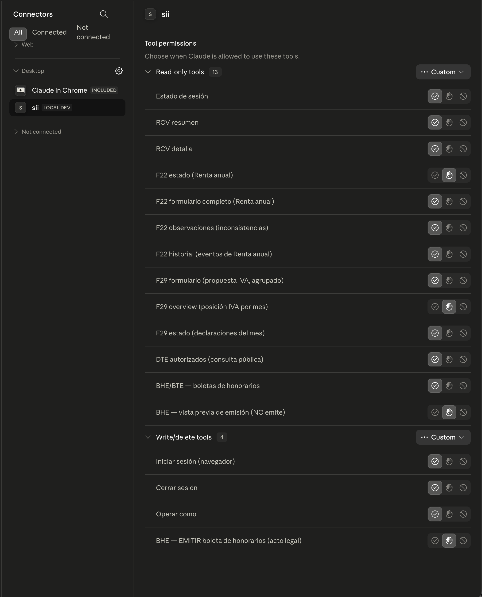

El proyecto `sii` permite consultar y automatizar con Claude los trámites rutinarios ante el SII de Chile (RCV, F29, F22 y boletas de honorarios) usando lenguaje natural. Es un núcleo TypeScript con CLI y servidor MCP, pensado para personas y para quienes representan empresas, y funciona con Claude Desktop y Claude Code.

## Qué es

El proyecto reúne tres paquetes sobre un mismo núcleo de dominio:

| Paquete | Función |
|---|---|
| `@albertomarturelo/sii-core` | Núcleo de dominio (librería Node) |
| `@albertomarturelo/sii-cli` | CLI `sii` para la terminal; Claude Code también puede usarla vía Bash |
| `@albertomarturelo/sii-mcp` | Servidor MCP (stdio), el punto de integración con Claude |

Como CLI y MCP comparten núcleo, los guardrails (límites de frecuencia, auditoría, manejo de credenciales e identidad) se aplican igual en ambas superficies. Según el repositorio, es una reescritura en TypeScript del `sii-cli` original en Python.

## Qué permite hacer

Según el estado documentado, estas superficies de **lectura** funcionan y están validadas en vivo:

- Autenticación y cambio del RUT con el que se opera (`auth`, `operate`).
- RCV (Registro de Compras y Ventas).
- F22: estado, formulario, observaciones e historial.
- F29 (Fase 1).
- Boletas de honorarios (BTE/BHE).
- DTE autorizados, una consulta pública que no requiere login.
- `whoami` y peticiones administrativas (SISPAD).
- Carpeta Tributaria: lista de instituciones destinatarias, leída directo del SII.

También incluye superficies que generan archivos o escriben datos:

- **Descarga de F29:** `f29 pdf` guarda en el disco el F29 presentado de un mes, su comprobante de pago (cuando el período fue pagado) y el Certificado de Declaración.
- **Boletas de honorarios:** `bte emit` emite una BHE. Por defecto muestra una vista previa y la emisión real exige confirmación.
- **Portal MIPYME:** `sii dte` prepara facturas (DTE 33/34) con la Clave, sin certificado digital, y las guarda como borrador. Entrega el PDF de vista previa y lee los documentos ya emitidos por el portal, con sus PDF.

## Seguridad y límites

- **Herramienta no oficial.** No está afiliada al SII. Automatiza el portal de un ente público, por lo que el repositorio recomienda usarla con criterio.
- **Bloqueo de cuenta.** El repositorio advierte que la cuenta se bloquea tras intentos fallidos y que no se debe reintentar después de un bloqueo.
- **La Clave no llega al modelo.** El login por navegador es cookies-only: el RUT y la Clave se teclean en la página real del SII. La CLI nunca escribe la Clave en ningún lado y el servidor MCP no accede al llavero.
- **Tres formas de iniciar sesión:** navegador (por defecto), consola (`--console`, con la Clave oculta) y llavero del sistema (`--keyring`, con la Clave que la persona usuaria guardó en Keychain o Secret Service, en un solo intento y sin re-login automático).
- **Segunda sesión para Carpeta Tributaria.** Esta función vive en la plataforma www2 del SII, que usa una sesión propia. Se inicia con `sii auth login --www2`, siempre en el navegador porque ahí corre reCAPTCHA. Ambas sesiones conviven en el mismo archivo.
- **Documentos fuera de la conversación.** Las herramientas de descarga (`f29_pdf`, `dte_pdf`, `dte_preview_pdf`) guardan el archivo en el disco y devuelven solo su ruta y tamaño. El contenido nunca entra al chat.
- **Permisos por herramienta.** Las acciones de escritura quedan controladas: iniciar y cerrar sesión, operar como otro RUT, guardar un borrador de factura y emitir una BHE. `bte_emit` y `dte_borrador_delete` son `destructive` y piden confirmación explícita.
- **Facturas.** La emisión no está expuesta en ninguna herramienta. Ese paso irreversible, con validez legal, queda en manos de la persona usuaria dentro de la interfaz del SII.

## Instalación

Requiere Node 20 o superior. Los pasos que indica el repositorio:

```bash
## 1) Instalación de la CLI y del servidor MCP
npm i -g @albertomarturelo/sii-cli @albertomarturelo/sii-mcp

## 2) Instalación del navegador que usa el login (una sola vez, ~100-150 MB)
npx playwright install chromium

## 3) Inicio de sesión: se abre el navegador en la página real del SII
sii auth login
```

Playwright es la única dependencia pesada y el paquete npm no descarga navegadores por su cuenta, por eso el paso 2 es obligatorio la primera vez.

## Conexión con Claude



El servidor usa stdio, así que no necesita hosting: Claude lo lanza como un proceso local.

**Claude Desktop.** Se añade lo siguiente a `claude_desktop_config.json` y se reinicia la app. En macOS el archivo está en `~/Library/Application Support/Claude/` y en Windows en `%APPDATA%\Claude\`.

```json
{
  "mcpServers": {
    "sii": { "command": "sii-mcp" }
  }
}
```

**Claude Code.** Se ejecuta un solo comando:

```bash
claude mcp add sii -- sii-mcp
```

Si la sesión aún no está iniciada, se corre `sii auth login` antes o se pide a Claude la herramienta `auth_login`, que abre el navegador.

## Ejemplos de prompts

La persona usuaria escribe en lenguaje natural y Claude elige la herramienta:

| Prompt de ejemplo | Herramienta |
|---|---|
| «¿Cuál es el estado de mi sesión y a nombre de qué RUT estoy operando?» | `auth_status` |
| «Muéstrame el resumen del RCV de compras del período 2026-05.» | `rcv_summary` |
| «¿Cómo quedó mi declaración de renta (F22) del año tributario 2025?» | `f22_status` / `f22_formulario` |
| «¿Cuál es mi posición de IVA mes a mes en el F29 durante 2026?» | `f29_overview` |
| «Descárgame el PDF del F29 de mayo 2026 con su comprobante de pago.» | `f29_pdf` |
| «Prepara un borrador de factura a mi cliente por $1.000.000 y muéstrame el PDF de vista previa.» | `dte_borrador_save` + `dte_preview_pdf` |
| «Lista las boletas de honorarios que recibí en junio 2026.» | `bte_list` |
| «¿Tengo peticiones administrativas detenidas ante el SII?» | `peticiones_list` |
| «Simula una boleta de honorarios de $500.000 a un cliente (sin emitir).» | `bte_emit_preview` |
| «Cambia a operar como la empresa que represento.» | `operate` |

## Uso desde la terminal

La CLI entrega JSON por defecto, útil para encadenar con `jq`, y acepta `--human` para lectura directa. Algunos comandos de ejemplo:

```bash
sii peticiones list            # trámites detenidos
sii rcv summary 2026-05        # resumen del RCV de compras
sii f29 overview 2026          # posición de IVA mes a mes
sii f29 pdf 2026-05            # PDF del F29 de mayo
sii dte emitidos --empresa <rut>   # documentos emitidos por el Portal MIPYME
```

## Modelo de identidad

Hay una sola cuenta activa a la vez; para cambiar de cuenta se hace `logout` y luego `login`. Dentro de la sesión, una cuenta de **persona** usa `operate` para elegir a nombre de qué RUT actúa: ella misma por defecto o una empresa que representa. Las cuentas de **empresa** no representan a nadie.

## Mi experiencia

Estudié en La Habana, y mi primer producto importante fue una aplicación de mensajería que utilizaban más de dos millones de cubanos, a pesar del limitado ancho de banda disponible en aquel momento. Desde 2020 vivo en Santiago de Chile; a lo largo de este tiempo, he trabajado en el sector bancario y de tecnología financiera en Chile, Perú, Brasil y España, casi siempre en el mismo tipo de proyecto: una aplicación en funcionamiento que necesitaba que se le prestara más atención.

Lo que me interesa de las aplicaciones móviles no tiene nada de glamuroso: la estabilidad, la seguridad y esos pequeños detalles que determinan si un usuario abrirá la aplicación mañana. De eso es de lo que escribo.